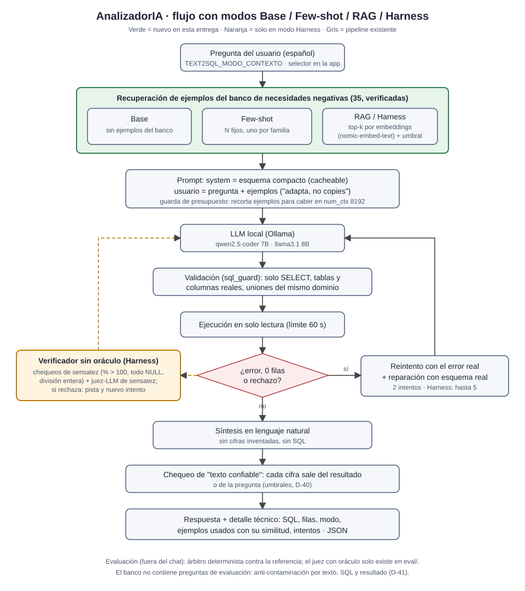

# Informe — Mejoras pedidas por el profesor: necesidades negativas, Few-shot, RAG y Harness

Fecha: 2026-10-26 · Rama `feat/few-shot-rag-harness-necesidades-negativas` · Ollama 0.40.5, RX 6600 de 8 GB, num_ctx 8192 · Decisiones D-41 a D-47 en [DECISIONES.md](DECISIONES.md).
Todas las cifras salen de corridas guardadas en `eval/resultados_modos/corridas/` (48 JSON) y de `eval/resultados_modos/resumen.{json,csv,md}`.

## 1. Qué pidió el profesor
1. **Necesidades negativas:** preguntas muy parecidas a las necesidades reales (2, 4, 5, 6 y 8), pero distintas, resueltas por un modelo grande e incluidas en el código.
2. **Recuperación:** cuando el usuario pregunte, el sistema busca la pregunta ya resuelta más parecida y se la da al modelo local como contexto.
3. **Comparar cuatro configuraciones en una tabla:** Base, Few-shot, RAG y Harness.

## 2. Qué se implementó
| Pieza | Dónde | Resumen |
|---|---|---|
| Banco de necesidades negativas | `llm/banco_ejemplos/`, `data/necesidades_negativas.json` | 35 (7 por familia). Cada SQL se ejecutó contra la base en solo lectura y la respuesta se generó desde el resultado. Anti-contaminación contra las 56 preguntas de evaluación (D-41). |
| Few-shot fijo | `llm/fewshot.py` | N ejemplos fijos, uno por familia (N = 3 por defecto). Guarda de presupuesto de tokens (D-43). |
| RAG | `llm/rag.py`, `data/indice_rag/` | Embeddings `nomic-embed-text` (Ollama) con respaldo TF-IDF; índice en disco; umbral calibrado solo con el banco (D-44). |
| Harness | `llm/harness.py` | RAG + hasta 5 intentos + verificador sin oráculo (sensatez + juez-LLM), sobre el pipeline existente (validadores, reintento con error real, reparación con esquema, texto confiable) (D-45). |
| Selector y trazabilidad | `llm/modo_contexto.py`, `app.py` | `TEXT2SQL_MODO_CONTEXTO` o selector en la barra lateral. El detalle técnico muestra los ejemplos y su similitud. El JSON exportado incluye `modo`, `ejemplos_usados`, `modelo`, `temperatura` e `intentos` (D-42). |
| Comparación | `eval/run_comparacion_modos.py` | 4 modos × 2 modelos × (6 casos del juez + DESARROLLO 30) × 3 repeticiones, con las mismas semillas (D-46). |

**Flujo:** pregunta → recuperación de ejemplos (según el modo) → prompt (esquema en el system; pregunta + ejemplos en el usuario) → LLM local → validación (sql_guard) → ejecución de solo lectura → reintento con el error real y reparación con esquema (Harness: verificador sin oráculo, hasta 5 intentos) → síntesis → chequeo de texto confiable → respuesta con trazabilidad.

## 3. Banco y recuperación
- **Banco:** 35 necesidades, 7 por familia. En la primera validación, 13 de 35 fallaron el control anti-contaminación: 11 se reescribieron, 1 cambió de contenido y 1 cambió de plantilla. Los umbrales no se movieron (D-41).
  - Similitud máxima frente a la evaluación: texto ≤ 0.348; SQL ≤ 0.640.
  - Ningún resultado de una negativa acierta una pregunta de evaluación.
- **RAG (calibración solo con el banco):**
  - Embeddings: familia correcta en el top-1 = 0.686 (dejando fuera la propia necesidad); umbral 0.664; 12/12 preguntas ajenas a la base no reciben ejemplos.
  - TF-IDF: 0.543; 8/12 ajenas bajo el umbral.
  - Con las 10 necesidades reales, embeddings acierta la familia en el top-1 en 10/10 y TF-IDF en 8/10.
- **Costo en tokens** (tokenizador real): system 3,333; bloque de 3 ejemplos sin respuesta 689 tokens. Caben hasta 10 ejemplos con respuesta en 8192 (D-43).

## 4. Resultados (3 repeticiones, T = 0.3, semillas 42/43/44, sin plantillas)
Regla D-23 para "mejora real": la media sube ≥ 1 y el mínimo nuevo es ≥ la media de Base.

| Modelo | Conjunto | Base | Few-shot | RAG | Harness |
|---|---|---|---|---|---|
| qwen2.5-coder 7B | 6 casos del juez | 1, 1, 1 (1.00) | 1, 1, 1 (1.00) | 3, 2, 2 (**2.33** ✔ D-23) | 3, 2, 2 (**2.33** ✔ D-23) |
| qwen2.5-coder 7B | DESARROLLO 30 | 14, 15, 15 (**14.67**) | 14, 13, 16 (14.33) | 13, 14, 14 (13.67) | 15, 15, 14 (14.67) |
| llama3.1 8B | 6 casos del juez | 1, 2, 1 (1.33) | 1, 1, 2 (1.33) | 2, 3, 3 (**2.67** ✔ D-23) | 3, 3, 3 (**3.00** ✔ D-23) |
| llama3.1 8B | DESARROLLO 30 | 16, 15, 13 (**14.67**) | 9, 6, 5 (6.67) | 10, 10, 11 (10.33) | 10, 12, 12 (11.33) |

**Costo por pregunta** (medias; tokens = suma de `prompt_eval_count` de las llamadas al generador de SQL):

| Modelo | Conjunto | Base | Few-shot | RAG | Harness |
|---|---|---|---|---|---|
| qwen | casos: tokens · s · intentos | 6,141 · 42.1 · 1.67 | 7,829 · 51.3 · 1.78 | 6,525 · 42.6 · 1.44 | 14,733 · 88.9 · 3.11 |
| qwen | DESARROLLO: tokens · s · intentos | 5,136 · 19.2 · 1.48 | 4,820 · 23.3 · 1.17 | 4,999 · 29.3 · 1.19 | 8,020 · 43.9 · 1.86 |
| llama3.1 | casos: tokens · s · intentos | 6,600 · 29.1 · 1.78 | 7,814 · 36.1 · 1.78 | 6,228 · 35.7 · 1.39 | 13,307 · 58.7 · 2.83 |
| llama3.1 | DESARROLLO: tokens · s · intentos | 4,575 · 14.7 · 1.32 | 5,159 · 23.4 · 1.24 | 5,281 · 26.1 · 1.26 | 8,593 · 39.3 · 2.00 |

Few-shot y RAG añaden ~700 tokens por llamada, pero a veces reducen los reintentos, así que el total por pregunta puede bajar. Harness casi duplica tokens y tiempo por sus reintentos y por la llamada del juez.

## 5. Por qué cada modo ayuda o no
**DESARROLLO separado en las 5 preguntas de las familias del banco (n02, n04, n05, n06, n08) y las otras 25** (aciertos medios):

| Modelo | Modo | Familia (de 5) | Resto (de 25) |
|---|---|---|---|
| qwen | Base / Few-shot / RAG / Harness | 0.33 / 1.00 / 0.00 / 0.33 | 14.33 / 13.33 / 13.67 / 14.33 |
| llama3.1 | Base / Few-shot / RAG / Harness | 0.33 / 0.00 / 2.00 / 2.00 | 14.33 / 6.67 / 8.33 / 9.33 |

1. **RAG ayuda dentro de su familia.** En los 6 casos del juez, los dos modelos suben de forma consistente y cumplen D-23. Por ejemplo, n05 (top 3 de categorías por flete) pasa de 0/3 a 3/3 con qwen. n06, que no había resuelto ninguna configuración de las rondas del juez, acierta en 1 de 3 repeticiones. Con llama3.1, las 5 preguntas de familia de DESARROLLO suben de 0.33 a 2.
2. **RAG estorba fuera de su familia, y mucho con llama3.1.** El banco es todo de las 5 familias. Con el umbral calibrado, casi cualquier pregunta sobre Olist recibe 3 ejemplos, y el modelo **copia filtros y estructura** en vez de adaptarlos:
   - x04 ("de todas las reseñas") hereda el filtro de pedidos válidos de los ejemplos y pasa de 3/3 a 0/3 con qwen.
   - x17 (top 2 ciudades de vendedores) copia el `HAVING >= 20` y el agrupamiento por vendedor de un ejemplo.
   - Con llama3.1, n05 pasa a agrupar por `seller_state` con `HAVING COUNT(*) >= 1000`, sacado literal del ejemplo.
   - También hay ganancias fuera de familia: x07, x15 y x18 suben de 0/3 a 3/3 con qwen, porque el ejemplo muestra cómo unir reseñas o productos con `vw_pedidos_validos`.
   - Con qwen el neto fuera de familia es −0.67; con llama3.1, −6.
3. **Few-shot fijo no ayuda.** En los casos del juez empata con Base, porque los 3 fijos (familias 2, 4 y 5) no suelen coincidir con la pregunta. En DESARROLLO con llama3.1 es el peor modo (6.67): aplica los mismos 3 ejemplos a todo y los copia.
4. **Harness = RAG + verificación.**
   - En DESARROLLO recupera parte de lo que pierde RAG: qwen 13.67 → 14.67 (= Base); llama3.1 10.33 → 11.33.
   - En los casos del juez con llama3.1 sube a 3.00 (3, 3, 3).
   - Cuesta casi el doble de tokens y tiempo. El juez de sensatez a veces rechaza un SQL correcto y fuerza reintentos.
5. **qwen es más robusto que llama3.1 al contexto extra.** qwen casi no se degrada fuera de familia; llama3.1 sí, lo que coincide con lo observado en la etapa 3 ("más texto no ayuda a un 8B").

**Conclusión honesta:** con estos datos, **ningún modo mejora a Base en DESARROLLO**, que es el conjunto amplio. RAG y Harness **sí mejoran las necesidades del dashboard** con los dos modelos (D-23 en los 6 casos), a cambio de empeorar otras preguntas, mucho con llama3.1. Por eso el chat sigue en **Base por defecto** (D-47). RAG/Harness quedan disponibles en el selector para las preguntas de las familias.

## 6. Limitaciones
- **El banco se escribió conociendo las preguntas de evaluación.** Los controles impiden copias (texto, SQL y resultado), pero las familias son justamente las que se evalúan: en los 6 casos del juez, RAG tiene ejemplos parecidos a propósito, que es lo que pidió el profesor. La mejora en esos casos **no es una estimación sobre preguntas nuevas**. PRUEBA_2 no se usó para medir.
- **Muestras pequeñas:** 6 casos y 30 preguntas, 3 repeticiones por configuración. Los intervalos se solapan; D-23 es la regla acordada, no una prueba de significancia.
- **El umbral de RAG solo separa preguntas ajenas a la base,** no "preguntas del dominio que no se parecen a ninguna familia". Es la causa principal de los daños fuera de familia.
- **Latencias:** durante la primera corrida (qwen, Base, casos, r1) se hizo una pregunta de prueba en la app, que pudo inflar la latencia de 1-2 preguntas. Las cifras dependen de Ollama 0.40.5 y de la GPU.
- **El Harness usa el juez de sensatez,** no el juez con oráculo de las etapas anteriores (que no serviría en el chat).

## 7. Siguientes pasos (propuestas, no implementadas)
1. **Umbral por familia o "RAG selectivo":** inyectar ejemplos solo si la pregunta se clasifica en una de las 5 familias, con un umbral calibrado para separar preguntas de familia de preguntas del dominio que no lo son (el umbral actual solo separa preguntas ajenas a la base). Hay que calibrarlo sin DESARROLLO y medirlo con un conjunto nuevo.
2. **Banco más amplio:** negativas para las demás familias (recompra, concentración, estacionalidad, geografía), para que fuera de familia no se recupere un ejemplo engañoso.
3. **Instrucción más dura contra la copia** (o mostrar solo el patrón, sin umbrales ni filtros literales), sobre todo para llama3.1.
4. **Un conjunto de prueba nuevo, escrito por un tercero,** para medir RAG sin el sesgo de autoría del banco.
